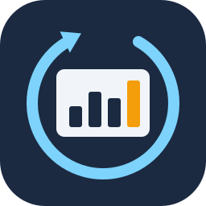

# provider-superset

`provider-superset` is a [Crossplane](https://crossplane.io) provider for
[Apache Superset](https://superset.apache.org). You describe database connections, datasets,
charts, dashboards, users, roles and the other parts of Superset as Kubernetes objects, and
Crossplane keeps Superset in line with them.

> This provider is an independent community project. It is not affiliated with, sponsored or
> endorsed by the Apache Software Foundation. Apache, Apache Superset and Superset are trademarks
> or registered trademarks of the Apache Software Foundation in the United States and/or other
> countries. This page uses them only to name the product that the provider works with.

[Upjet](https://github.com/crossplane/upjet) generated the provider from the
[Superset Terraform provider](https://registry.terraform.io/providers/platacard/superset/latest)
of Plata Card. The provider runs the Terraform provider inside its own process, so the package
needs no Terraform binary, and the resources behave like their Terraform counterparts.
[The Terraform provider inside](docs/terraform-provider.md) lists the version and our fixes.

## What you can manage

The provider has 24 managed resources in 11 API groups:

| Area | Kinds |
|------|-------|
| Users and access | Role, RolePermissions, User, Group, RowLevelSecurity |
| Database connections | Database, MetaDatabase, DatabasePermissionsSync |
| Datasets | Dataset, DatasetRefresh |
| Charts and dashboards | Chart, Dashboard, DashboardEmbedding, CSSTemplate, Theme |
| SQL Lab | SavedQuery |
| Annotations | AnnotationLayer, Annotation |
| Tags | Tag |
| Alerts and reports | Report |
| Imports of exported dashboards | AssetsImport, DashboardImport, ChartImport, DatasetImport |

Every kind exists twice. The cluster-scoped variant uses the API groups
`*.superset.crossplane.io`. The namespaced variant, which Crossplane v2 introduced, uses
`*.superset.m.crossplane.io`. [Managed resources](docs/resources.md) lists every kind with its
group, its Terraform resource and its external name.

## What you need

* Kubernetes with Crossplane v2. We test the provider with Crossplane 2.4.
* Apache Superset 6.1. Most kinds also work with older versions, but Group, Theme and
  DatabasePermissionsSync need Superset 6.
* A Superset user that may manage what you describe, usually an admin. The provider signs in
  with a username and a password, against the Superset database (`AUTH_DB`) or LDAP.
* `FAB_ADD_SECURITY_API = True` in `superset_config.py` if you manage users, roles, groups or
  permissions. Some kinds need feature flags, which [Behaviour](docs/behaviour.md#feature-flags)
  lists.

## Install the provider

1. Install Crossplane, if your cluster does not have it yet.

   ```shell
   helm repo add crossplane-stable https://charts.crossplane.io/stable
   helm install crossplane crossplane-stable/crossplane --namespace crossplane-system --create-namespace
   ```

2. Install the provider package. Replace the version with the latest release.

   ```yaml
   apiVersion: pkg.crossplane.io/v1
   kind: Provider
   metadata:
     name: provider-superset
   spec:
     package: ghcr.io/hayone1/provider-superset:v0.1.0
   ```

3. Wait until the provider is healthy.

   ```shell
   kubectl wait provider.pkg/provider-superset --for=condition=Healthy --timeout=5m
   ```

## Connect the provider to Superset

Put the Superset URL and the sign-in details into a Secret. Then create a provider configuration
that points at the Secret.

```shell
kubectl create secret generic superset-creds -n crossplane-system \
  --from-literal=credentials='{"host": "https://superset.example.com", "username": "admin", "password": "change-me"}'
```

```yaml
# For namespaced managed resources. Every namespace can use it.
apiVersion: superset.m.crossplane.io/v1beta1
kind: ClusterProviderConfig
metadata:
  name: default
spec:
  credentials:
    source: Secret
    secretRef:
      namespace: crossplane-system
      name: superset-creds
      key: credentials
---
# For cluster-scoped managed resources.
apiVersion: superset.crossplane.io/v1beta1
kind: ProviderConfig
metadata:
  name: default
spec:
  credentials:
    source: Secret
    secretRef:
      namespace: crossplane-system
      name: superset-creds
      key: credentials
```

[Authentication](docs/authentication.md) explains every key of the credentials, LDAP, CSRF
protection, TLS with your own certificate authority, and ProviderConfigs per namespace.

## Create your first resources

This example connects Superset to a PostgreSQL database, adds a dataset for the table
`public.sales`, and builds a chart on it. The database password comes from a Secret. Create the
namespace first:

```shell
kubectl create namespace analytics
```

Then save the manifest as `analytics.yaml`, and apply it with `kubectl apply -f analytics.yaml`.

```yaml
apiVersion: v1
kind: Secret
metadata:
  name: warehouse-db
  namespace: analytics
stringData:
  password: change-me
---
apiVersion: database.superset.m.crossplane.io/v1alpha1
kind: Database
metadata:
  name: warehouse
  namespace: analytics
spec:
  forProvider:
    connectionName: Warehouse
    dbEngine: postgresql
    dbHost: warehouse.example.com
    dbPort: 5432
    dbName: warehouse
    dbUser: superset
    dbPassSecretRef: {name: warehouse-db, key: password}
    exposeInSqllab: true
    allowRunAsync: false
    allowCtas: false
    allowCvas: false
    allowDml: false
---
apiVersion: dataset.superset.m.crossplane.io/v1alpha1
kind: Dataset
metadata:
  name: sales
  namespace: analytics
spec:
  forProvider:
    databaseNameRef: {name: warehouse}
    schema: public
    tableName: sales
---
apiVersion: chart.superset.m.crossplane.io/v1alpha1
kind: Chart
metadata:
  name: sales-by-region
  namespace: analytics
spec:
  forProvider:
    name: Sales by region
    vizType: table
    datasourceIdRef: {name: sales}
    params: |
      {"viz_type": "table", "query_mode": "aggregate", "groupby": ["region"], "metrics": ["count"], "row_limit": 100}
```

Check the result with `kubectl get managed -n analytics`. Each managed resource becomes
`READY` and `SYNCED`, and `status.atProvider.id` shows the ID of the object in Superset. The
[getting started guide](docs/getting-started.md) walks through these steps, adds a dashboard
and a user, and cleans up at the end. [examples/](examples) has a complete manifest for every
kind in both API variants.

## Documentation

* [Getting started](docs/getting-started.md): a first tutorial, from an empty cluster to a chart.
* [Authentication](docs/authentication.md): credentials, LDAP, CSRF, TLS and ProviderConfigs.
* [Managed resources](docs/resources.md): every kind, its group, its external name and its references.
* [Dashboards and imports](docs/dashboards.md): put charts on dashboards, and manage dashboards
  as exported YAML files.
* [Behaviour](docs/behaviour.md): how the provider finds, changes and deletes objects, and the
  limits that come from Superset.
* [Troubleshooting](docs/troubleshooting.md): what common error messages mean.
* [The Terraform provider inside](docs/terraform-provider.md): the version and our fixes.
* [Development](contributing/development.md): how to build, generate and test the provider.

## How the provider differs from the Terraform provider

| | Terraform provider | This provider |
|---|---|---|
| Credentials | `host`, `username` and `password` arguments or `SUPERSET_*` variables | A Secret, the environment or a file, as a JSON object. `SUPERSET_*` variables of the provider pod have no effect. |
| Import kinds | `source` (a directory or zip file) or `files` | `files` only. The provider cannot read files of your machine, and it does not read files of its own pod. |
| Passwords of an import | Keyed by the path of the database file | Keyed by the file name, because Secret keys cannot contain `/` |
| Existing objects | `terraform import` | The `crossplane.io/external-name` annotation, set to the numeric ID |
| Settings left out | Kept as Superset has them | The same. Late initialization is off, so `spec.forProvider` keeps only what you set, and `status.atProvider` shows the rest. |
| Validation | When Terraform plans | Before each create and update, with the same checks |
| Data sources | 14 | None. Crossplane manages objects. Use `status.atProvider` of a managed resource, or the Superset API. |

## Development

```shell
make submodules      # once
make generate        # regenerates the APIs, controllers and CRDs
go test ./config/... ./internal/...
make superset.up     # Superset 6.1 and PostgreSQL in Docker
cp example.env .env  # the address and the account of that Superset
test/e2e/run.sh      # every example, against that Superset
```

[contributing/development.md](contributing/development.md) has the details.

## License

Apache 2.0, see [LICENSE](LICENSE).
